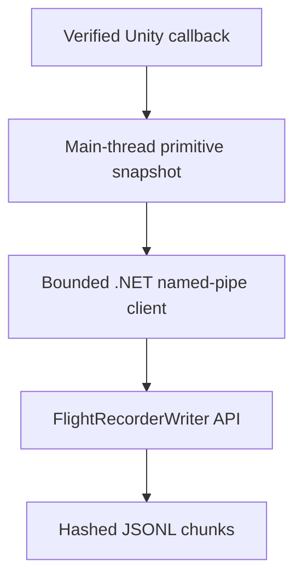

# Flight Recorder writer deployment connection

**State:** offline core and bounded Windows local transport are implemented. The Unity adapter remains unbuilt pending the installed-game audit. This document is a connection specification, not a deployable plug-in or gameplay-validation claim.

## Connection point

`tools/flight_writer.py` is a Python standard-library module. A Unity-facing adapter must copy engine state into immutable primitive messages on a verified callback, then hand those messages to the local pipe client. The adapter must never pass Unity object references, `Transform`, `Rigidbody`, `GameObject`, or mutable game collections to the background writer.

The implemented bridge is `plugin/FlightRecorder.TransportClient` plus `tools/flight_transport.py`; it uses a current-user Windows pipe DACL, rejects remote clients, bounds messages/queues, and acknowledges accepted messages. See [FLIGHT_RECORDER_TRANSPORT.md](FLIGHT_RECORDER_TRANSPORT.md). This bridge has only synthetic end-to-end evidence and does not provide a game-side observer.

## Writer API mapping

| Future adapter observation | Writer call | Required data and rule |
|---|---|---|
| One global physics callback | `submit_frame(FrameSnapshot(...))` | One monotonically increasing source step; one time and phase for all samples; copy primitive pose/velocity/state fields. Never synthesize a missing step. |
| Entity spawn/despawn | `submit_lifecycle(EntityLifecycleRecord(...))` | Stable per-spawn ID; emit despawn only when observed. A reused source handle increments its generation. |
| Decision, command or outcome | `submit_event(RecorderEvent(...))` | Preserve source event name, timestamp, step if observed, entity/correlation IDs, evidence grade and exact structured fields. Missing values remain absent. |
| External source or transport loss | `mark_incomplete(reason, details=...)` | Bounded reason ledger; final `capture_complete` is false and metadata preserves first/last bounded details. Do not synthesize a frame for a missing step. |
| Stop/health reporting | `stats()` then `close()` | Surface queue loss, storage exhaustion, rejected events, incomplete capture and final chunk/manifest state to the local operator. |

Stable IDs should use the source actor handle plus a spawn generation, for example `human:73:2`. IDs must not use a reusable display name alone. Entity-kind and source-handle normalization belongs in the adapter; the recorder does not infer identity from position or names.

For a decision input, the adapter may pass the complete, actually observed replay contract as `RecorderEvent.fields`: `policy_version`, `state_version`, validated profile and hash, candidate list with status and real eligibility/mechanical gates, and observations. The event's top-level `id`, `decision_id`, `step` and `t` must refer to the same decision. A replayable record also requires a matching same-step physics frame. If any value is unavailable, omit it and let `tools/replay_decisions.py` report the decision as incomplete. Do not convert the legacy M2 `LogEvent` stream into fabricated decision inputs or claim Python reference-policy agreement as production M2 parity.

## Bounded behavior and operator contract

| Condition | Core behavior | Adapter/operator action |
|---|---|---|
| Frame queue full | `submit_frame` returns `queue_saturated`; a bounded gap is queued with step and sample counts where known. Capacity is reserved for control records. | Surface degraded capture. If the gap ledger is full and the call raises, retain/retry or stop; do not ignore the exception. |
| Event queue full | Uses the reserved control slots/bytes, preserving FIFO order. If still full, waits at most the configured timeout, then raises `RecorderOverloadError`; the event was not accepted. | Retain/retry the exact event or stop with an incomplete run. Never report an unrecorded decision as captured. |
| Storage or chunk cap | Ordinary writes stop; affected frames and rejected controls are accounted for in metadata and reserved final gap records where space remains. | Stop producing telemetry, preserve the run directory and show `capture_complete=false`. |
| Process interruption | Finalized chunks remain independently hash-checked; complete lines in `.partial` chunks can be salvaged; known step gaps are emitted. | Run `recover_run()` on a copy of the stopped run; preserve corrupt and archived source files for diagnosis. |

`max_storage_bytes` is a hard run-directory limit; `control_reserve_bytes` leaves space for the manifest, state, metadata and final loss records. `max_chunks` includes one reserved chunk for emergency accounting. Configure limits from an expected session length and disk budget before game testing; a synthetic benchmark is not a safe default profile for every user's machine.

## Audit gates

### Requires installed game files

- Run `scripts/inspect_unity_install.py` read-only against the user's current installation root; record executable/build hashes locally.
- Establish actual Unity version, Mono/IL2CPP backend, permitted loader, plugin ABI and current Custom Logic/API behavior.
- Determine whether an approved callback exists at the required physics phase and which actor classes it can observe.
- Choose the compatible adapter/transport and exact files, install path, launch settings and rollback. Do not infer these from the public release listing or another user's game.

### Requires actual gameplay

- Calibrate callback ordering and timestamps against a short local video; verify and preserve the actual phase label (`fixed_update_pre_physics` if that seam is selected).
- Measure per-step global coverage across representative actors, spawn/despawn and scene transitions; validate explicit gap/drop reporting.
- Exercise decision, command, damage and rescue event provenance in a private master-host session; prove correlation without inferring outcomes.
- Measure game frame time, CPU, memory, queue pressure, storage and shutdown behavior at representative load. Confirm no gameplay mutations and no material performance regression.

The official release listing was reachable in the cloud, but the 1 GB Windows archive could not be retrieved and inspected here. The installed version remains unknown; see [REC-I status](REC_I_VALIDATION_BLOCKER.md). No Unity physics or in-game validation is claimed by the offline tests or benchmark.
